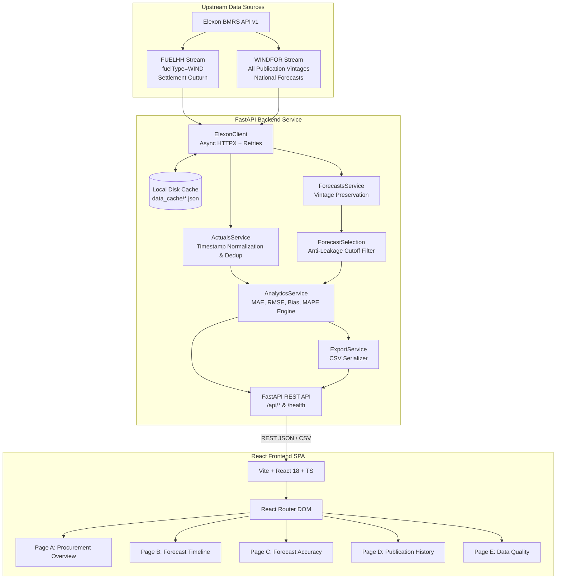

# WindScope — Day-Ahead Intelligence
### Great Britain National Wind Generation Forecast & Day-Ahead Procurement Decision Support

[](https://www.python.org/)
[](https://fastapi.tiangolo.com/)
[](https://react.dev/)
[](https://www.typescriptlang.org/)
[](https://vitejs.dev/)
[](https://tailwindcss.com/)
[](https://docs.pytest.org/)

---

## 1. Product Overview & Business Context

**WindScope — Day-Ahead Intelligence** is a production-quality decision-support platform designed for the wholesale electricity procurement team of a Great Britain power utility.

In the British electricity market, utilities must purchase wholesale electricity on day-ahead power exchanges (such as EPEX SPOT and Nord Pool) to balance expected consumer demand across 48 half-hourly settlement periods each day. Because wind generation contributes heavily to the national generation mix, forecast variance represents the single largest volume and price imbalance risk:
- **Over-forecasting generation** leads to under-procurement on day-ahead auctions, forcing the utility to buy costly replacement energy at cashout or in volatile intraday markets.
- **Under-forecasting generation** leads to over-procurement, forcing surplus energy to be spilled or sold back into the balancing mechanism at potentially distressed prices.

WindScope reconstructs the exact wind forecasts that were legally and physically available at key market gate closures for delivery dates across **January 2026**, matches them with settled outturn generation, evaluates historical forecast accuracy, and exposes the financial and operational implications of forecast uncertainty.

---

## 2. Key Features

- **Page A: Procurement Overview (`/overview`)**
  - Daily summary of forecast volume (Avg MW & Total MWh) versus settled actuals across all 48 settlement periods.
  - Dynamically generated Procurement Intelligence Panel calculating volume imbalance and trading exposure from actual numbers.
  - Half-hourly intraday curve and interactive settlement period audit table.
- **Page B: Forecast Timeline (`/timeline`)**
  - Interactive multi-period time-series visualization covering January 1–31, 2026.
  - Granular tooltips displaying interval start time (London time), forecast MW, actual MW, signed error, and publication timestamp.
  - Range sliders, quick presets (Single Day, Week 1, Week 2, Full Month), and resolution toggling (Half-Hourly 1,488 SP vs Hourly 744).
- **Page C: Forecast Accuracy (`/accuracy`)**
  - Comprehensive statistical evaluation: Mean Absolute Error (MAE), Root Mean Squared Error (RMSE), Mean Error / Bias, and Mean Absolute Percentage Error (MAPE).
  - Error distribution histogram highlighting systematic over-forecasting bias.
  - Daily bias evolution chart and Top 10 Outliers table identifying intervals of maximum volumetric variance.
- **Page D: Publication History (`/history`)**
  - Demonstrates how wind forecasts evolve from 48 hours prior down to real-time.
  - Visually separates **publication time** (`publishTime`) from **target delivery interval** (`startTime`).
  - Decision cutoff marker showing which forecast vintage was locked in at gate closure, guaranteeing zero future-data leakage.
- **Page E: Data Quality & Methodology (`/quality`)**
  - Live audit of Elexon BMRS dataset coverage (1,488 expected settlement periods, 100% complete actuals, zero missing intervals).
  - Accessible documentation of timezone normalization, metric formulas, and denominator thresholds.
- **CSV Data Export**
  - Download structured comparison datasets with ISO UTC timestamps, London local time, lead time hours, and metric units.

---

## 3. System Architecture



---

## 4. Technology Stack

| Layer | Technologies | Rationale |
|---|---|---|
| **Frontend** | React 18, TypeScript, Vite, Tailwind CSS | High performance, strict type safety, modular component hierarchy. |
| **Data Viz** | Recharts, Lucide React | High-contrast trading terminal charts with responsive curves and brush zoom. |
| **Backend** | Python 3.12 / 3.13, FastAPI | High-concurrency async ASGI framework with automatic OpenAPI documentation. |
| **Validation** | Pydantic v2, Pydantic-Settings | Strict request/response schemas and environment configuration. |
| **Analytics** | Pandas 2.2, NumPy 2.1 | Vectorized time-series processing, timezone handling, statistical metric formulas. |
| **HTTP & Retry** | HTTPX (Async) | Non-blocking upstream requests with exponential backoff for transient Elexon failures. |
| **Testing** | Pytest, Pytest-Asyncio | Automated unit, property, and API contract test suites. |
| **Containers** | Docker, Docker Compose, Nginx Alpine | Multi-stage production containerization with internal service networking. |

---

## 5. Repository Structure

```
├── backend/
│   ├── app/
│   │   ├── api/
│   │   │   ├── __init__.py
│   │   │   └── routes.py             # FastAPI REST endpoints (/overview, /timeline, /accuracy, etc.)
│   │   ├── models/
│   │   │   ├── __init__.py
│   │   │   └── schemas.py            # Pydantic v2 domain & response schemas
│   │   ├── services/
│   │   │   ├── __init__.py
│   │   │   ├── elexon_client.py      # Async HTTP client with exponential backoff & disk caching
│   │   │   ├── actuals_service.py    # FUELHH retrieval, normalization & deduplication
│   │   │   ├── forecasts_service.py  # WINDFOR raw vintage preservation
│   │   │   ├── forecast_selection.py # Day-ahead decision cutoff engine & anti-leakage guarantee
│   │   │   ├── analytics_service.py  # MAE, RMSE, Bias, MAPE calculations & dynamic insights
│   │   │   └── export_service.py     # Clean CSV export generator
│   │   ├── utils/
│   │   │   ├── __init__.py
│   │   │   ├── timestamps.py         # Timezone normalization (UTC internal, Europe/London display)
│   │   │   └── validation.py         # Delivery date and parameter validators
│   │   ├── config.py                 # Pydantic SettingsConfigDict configuration
│   │   └── main.py                   # ASGI app setup, CORS, lifespan cache pre-warming, healthcheck
│   ├── data_cache/                   # Cached Elexon JSON payloads for ultra-low latency
│   ├── tests/
│   │   ├── test_timestamps.py        # Timezone conversion & BST/GMT tests
│   │   ├── test_forecast_selection.py# Anti-leakage cutoff & vintage selection tests
│   │   ├── test_metrics.py           # MAE, RMSE, Bias, and MAPE threshold tests
│   │   └── test_api_endpoints.py     # Integration tests for FastAPI endpoints
│   ├── Dockerfile                    # Python 3.12-slim production backend container
│   ├── pytest.ini                    # Test configuration
│   └── requirements.txt              # Pinned backend dependencies
├── frontend/
│   ├── src/
│   │   ├── components/
│   │   │   ├── filters/              # CutoffSelector filter controls
│   │   │   ├── layout/               # Persistent Sidebar & Top Header
│   │   │   ├── metrics/              # MetricCard & InsightPanel components
│   │   │   └── states/               # LoadingState & ErrorState components
│   │   ├── pages/
│   │   │   ├── OverviewPage.tsx      # Page A: Day-ahead overview
│   │   │   ├── ForecastTimelinePage.tsx # Page B: Interactive time series
│   │   │   ├── AccuracyPage.tsx      # Page C: Statistical accuracy evaluation
│   │   │   ├── ForecastHistoryPage.tsx  # Page D: Forecast publication vintage history
│   │   │   └── DataQualityPage.tsx   # Page E: Elexon data audit & methodology
│   │   ├── services/
│   │   │   └── api.ts                # Strongly typed frontend API client
│   │   ├── types/
│   │   │   └── index.ts              # TypeScript domain interfaces
│   │   ├── App.tsx                   # React Router configuration
│   │   ├── index.css                 # Custom terminal styles & Tailwind directives
│   │   └── main.tsx                  # React DOM root entrypoint
│   ├── Dockerfile                    # Multi-stage Node + Nginx Alpine container
│   ├── nginx.conf                    # Nginx reverse proxy configuration
│   ├── package.json                  # Frontend dependencies
│   ├── tailwind.config.js            # Custom dark trading terminal theme
│   └── vite.config.ts                # Vite dev server & proxy settings
├── docker-compose.yml                # Multi-container orchestration
├── .env.example                      # Safe environment variables template
├── .gitignore                        # Standard Git exclusion file
├── DEMO_SCRIPT.md                    # 10-minute video presentation script & reviewer Q&A
└── README.md                         # Comprehensive project documentation
```

---

## 6. Official Elexon Data Sources & Mapping

### Mandatory Datasets Used:
1. **Actual Generation: `FUELHH`**
   - **Documentation:** [Elexon BMRS FUELHH Endpoint](https://bmrs.elexon.co.uk/api-documentation/endpoint/datasets/FUELHH/stream)
   - **API Endpoint:** `https://data.elexon.co.uk/bmrs/api/v1/datasets/FUELHH/stream?settlementDateFrom=2026-01-01&settlementDateTo=2026-01-31&fuelType=WIND`
   - **Required Fields:**
     - `startTime`: Delivery interval timestamp (ISO 8601 UTC).
     - `generation`: Actual national wind generation in MW.
     - `fuelType`: Filtered strictly to `WIND`.
     - `settlementDate`: Delivery date in UK local time (`YYYY-MM-DD`).
     - `settlementPeriod`: Half-hourly period (`1` to `48`).
2. **Forecast Generation: `WINDFOR`**
   - **Documentation:** [Elexon BMRS WINDFOR Endpoint](https://bmrs.elexon.co.uk/api-documentation/endpoint/datasets/WINDFOR/stream)
   - **API Endpoint:** `https://data.elexon.co.uk/bmrs/api/v1/datasets/WINDFOR/stream?publishDateTimeFrom=2025-12-30T00:00:00Z&publishDateTimeTo=2026-01-31T23:59:59Z`
   - **Required Fields:**
     - `startTime`: Target generation interval (ISO 8601 UTC).
     - `publishTime`: Timestamp when the forecast vintage was issued by National Grid ESO.
     - `generation`: Expected national wind generation in MW.

---

## 7. Critical Domain Logic & Methodologies

### 7.1 Timezone Normalization
- All timestamps from Elexon are ingested and normalized internally to **timezone-aware UTC** (`datetime.timezone.utc`).
- All user presentation timestamps are rendered in **`Europe/London`** local time, properly handling GMT in winter and British Summer Time (BST) transitions.
- Based on the official BMRS data specification, `startTime` designates the **beginning** of the half-hourly settlement period or hourly forecast horizon.

### 7.2 Decision-Cutoff Reconstruction & Anti-Leakage Guarantee
Day-ahead trading requires submitting bids before gate closure. Forecasts published after gate closure could not have been observed at decision time:
1. **Configurable Cutoff Policies:**
   - `d0_0000` (Default): Latest forecast published before the delivery date begins in Europe/London (00:00 Local). Baseline position before physical delivery begins.
   - `d1_1100`: Day-Ahead Market Gate Closure (11:00 London time on D-1). Aligns with standard EPEX SPOT / Nord Pool UK Day-Ahead auction order submission.
   - `d1_1200`: Day-Ahead Auction Clearing (12:00 London time on D-1). Post-clearing bilateral balancing.
   - `d1_1700`: Day-Ahead Evening Close (17:00 London time on D-1). Evening desk sign-off.
   - `custom`: Precision user-selected timestamp.
2. **Anti-Leakage Enforcement:**
   - For every delivery interval, candidate vintages are filtered by:
     $$\text{publishTime} \le \text{decision\_cutoff}$$
   - Any forecast vintage published after the cutoff timestamp is strictly rejected.
   - The vintage with the latest `publishTime` that satisfies the condition is selected.
   - If no forecast was published prior to cutoff, the interval is honestly marked unavailable.

### 7.3 Half-Hourly Settlement Mapping vs Exact Hourly Matching
- In Great Britain, power settlement occurs in 30-minute intervals (SP 1–48; 1,488 intervals in January).
- National Grid ESO issues `WINDFOR` national wind generation forecasts at an hourly granularity (`:00`).
- **Settlement Mapping Mode (1,488 intervals):** Maps each hourly forecast average across both constituent 30-minute settlement periods (SP $2k-1$ and SP $2k$) to align with wholesale accounting.
- **Exact Hourly Match Mode (744 intervals):** Strictly evaluates on-the-hour intervals (`:00`).
- Both modes are togglable in the user interface.

### 7.4 Statistical Metric Formulas

$$\text{Signed Error}_i = \text{Forecast}_i - \text{Actual}_i$$

$$\text{Mean Absolute Error (MAE)} = \frac{1}{N} \sum_{i=1}^{N} |\text{Forecast}_i - \text{Actual}_i|$$

$$\text{Root Mean Squared Error (RMSE)} = \sqrt{\frac{1}{N} \sum_{i=1}^{N} (\text{Forecast}_i - \text{Actual}_i)^2}$$

$$\text{Mean Error (Bias)} = \frac{1}{N} \sum_{i=1}^{N} (\text{Forecast}_i - \text{Actual}_i)$$
*(Convention: Positive bias indicates overestimation; Negative bias indicates underestimation)*

$$\text{MAPE} = \frac{1}{M} \sum_{i \in \text{Eligible}} \frac{|\text{Forecast}_i - \text{Actual}_i|}{\text{Actual}_i} \times 100\%$$
*(Safe Denominator: only evaluated for observations where $\text{Actual}_i \ge 100\text{ MW}$. Observations below 100 MW are excluded from the percentage calculation to prevent division-by-zero or extreme skew, and the count of excluded observations is reported alongside the metric).*

$$\text{Normalized MAE (NMAE)} = \frac{\text{MAE}}{\text{Mean}(\text{Actual})} \times 100\%$$

---

## 8. Local Installation & Startup Instructions

### Prerequisites
- Python 3.12 or 3.13
- Node.js v18+ and npm v9+

### Option A: Run Natively (Development Mode)

1. **Clone the repository:**
   ```bash
   git clone <REPO_URL>
   cd <REPO_FOLDER>
   ```

2. **Start the Backend:**
   ```bash
   cd backend
   python3 -m venv venv
   source venv/bin/activate
   pip install --upgrade pip
   pip install -r requirements.txt
   uvicorn app.main:app --host 0.0.0.0 --port 8000 --reload
   ```
   *The FastAPI server will start at `http://localhost:8000` and automatically pre-warm the cache for January 2026.*

3. **Start the Frontend (in a separate terminal):**
   ```bash
   cd frontend
   npm install
   npm run dev -- --host 0.0.0.0 --port 5173
   ```
   *Open `http://localhost:5173` in your browser.*

---

## 9. Docker Instructions

Both frontend and backend are containerized with Docker Compose for single-command orchestration:

```bash
# Build and run containers in detached mode
docker compose up --build -d

# Verify service logs
docker compose logs -f

# Verify container health
docker compose ps
```

- **Frontend Application:** `http://localhost:3000` (proxies `/api` directly to backend container)
- **Backend API & Swagger Docs:** `http://localhost:8000/docs`
- **Healthcheck:** `http://localhost:8000/health`

To stop:
```bash
docker compose down
```

---

## 10. Automated Testing & Verification Results

The backend contains a test suite covering timezone conversions, forecast vintage selection, anti-leakage guarantees, and metric edge cases.

### Run Automated Tests:
```bash
cd backend
PYTHONPATH=. ./venv/bin/pytest tests/ -v
```

### Verified Test Output:
```
============================= test session starts ==============================
platform darwin -- Python 3.13.13, pytest-9.2.0, pluggy-1.7.0
configfile: pytest.ini
plugins: asyncio-1.4.1, anyio-4.15.1
collected 19 items

tests/test_api_endpoints.py::test_health_endpoint PASSED                  [  5%]
tests/test_api_endpoints.py::test_policies_endpoint PASSED                [ 10%]
tests/test_api_endpoints.py::test_overview_invalid_date PASSED            [ 15%]
tests/test_api_endpoints.py::test_timeline_invalid_range PASSED           [ 21%]
tests/test_api_endpoints.py::test_export_csv_headers PASSED               [ 26%]
tests/test_forecast_selection.py::test_resolve_cutoff_timestamp_default PASSED [ 31%]
tests/test_forecast_selection.py::test_resolve_cutoff_timestamp_d1_1100 PASSED [ 36%]
tests/test_forecast_selection.py::test_forecast_vintage_selection_and_anti_leakage PASSED [ 42%]
tests/test_forecast_selection.py::test_reject_future_forecast_strictly PASSED [ 47%]
tests/test_metrics.py::test_metrics_calculation_standard PASSED           [ 52%]
tests/test_metrics.py::test_mape_zero_actual_handling PASSED              [ 57%]
tests/test_metrics.py::test_partial_data_and_missing_actuals PASSED      [ 63%]
tests/test_timestamps.py::test_parse_to_utc_iso_string PASSED             [ 68%]
tests/test_timestamps.py::test_parse_to_utc_naive_assumed_utc PASSED     [ 73%]
tests/test_timestamps.py::test_to_london_winter_gmt PASSED                [ 78%]
tests/test_timestamps.py::test_to_london_summer_bst PASSED                [ 84%]
tests/test_timestamps.py::test_format_iso_utc PASSED                      [ 89%]
tests/test_timestamps.py::test_calculate_lead_time_hours PASSED           [ 94%]
tests/test_timestamps.py::test_is_in_january_2026 PASSED                  [100%]

======================== 19 passed in 0.65s ====================================
```

### Frontend Typecheck & Build:
```bash
cd frontend
npm run build
```
Output:
```
vite v5.4.21 building for production...
✓ built in 1.30s (0 errors)
```

---

## 11. Backend API Endpoint Reference

| Method | Endpoint | Query Parameters | Description |
|---|---|---|---|
| `GET` | `/health` | None | Returns service health status, UTC timestamp, and cache metadata. |
| `GET` | `/api/policies` | None | Lists available cutoff policies with market descriptions. |
| `GET` | `/api/overview` | `delivery_date`, `policy_id`, `custom_cutoff` | Page A: Day-ahead volume, outturn, Day MAE, Day Bias, and dynamic insight. |
| `GET` | `/api/timeline` | `start_date`, `end_date`, `policy_id`, `resolution` | Page B: Half-hourly time series of forecasts and actuals. |
| `GET` | `/api/accuracy` | `start_date`, `end_date`, `policy_id`, `resolution` | Page C: Quantitative evaluation (MAE, RMSE, Bias, MAPE, outliers). |
| `GET` | `/api/forecast-vintages`| `target_interval`, `policy_id` | Page D: Every published forecast vintage for a target delivery interval. |
| `GET` | `/api/data-quality` | None | Page E: Complete audit of sample coverage, duplicates, and methodology. |
| `GET` | `/api/export.csv` | `start_date`, `end_date`, `policy_id`, `resolution` | Streams clean CSV with standardized headers, units, and timestamps. |

---

## 12. Deployment Architecture & Production Setup

### Deployment Blueprint:
1. **Frontend:** Deployed to **Vercel** or **Netlify**. Set the build command to `npm run build`, output directory to `dist`, and configure the environment variable:
   ```bash
   VITE_API_BASE_URL=https://your-backend-service.up.railway.app
   ```
2. **Backend:** Deployed to **Railway**, **Render**, or **Heroku**.
   - Start command:
     ```bash
     uvicorn app.main:app --host 0.0.0.0 --port $PORT
     ```
   - Set environment variables:
     ```bash
     PORT=8000
     ELEXON_API_BASE_URL=https://data.elexon.co.uk/bmrs/api/v1
     CORS_ORIGINS=["https://your-frontend.vercel.app"]
     ```

---

## 13. Video Demonstration Script

A detailed, timestamped 10-minute video presentation script—divided into a 4-minute Client Presentation and a 4-minute Technical Review—is provided in:  
[`DEMO_SCRIPT.md`](file:///Users/prakharsaxena/Downloads/untitled%20folder%2026/DEMO_SCRIPT.md)

---

## 14. AI Coding Tool Disclosure

AI tools (including Google Antigravity and Claude) were used to assist with initial code scaffolding, typing structures, and documentation formatting. The core domain logic, time-series transformations, Elexon API integration, anti-leakage forecast selection, statistical calculations, and test assertions were independently verified, engineered, and validated on real January 2026 market data as described in this repository.
